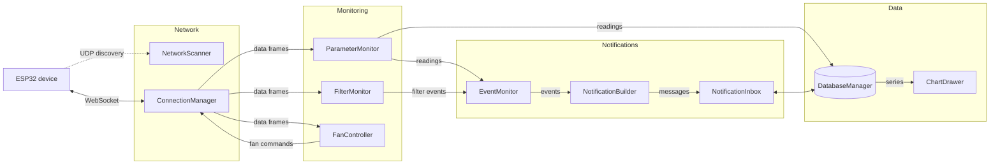

# AirMonitor 

## Under Development 🚧 

An intellignet, air purifing device, built on ESP32-S3 mircocontroller, controlled by mobile app (C++ / Qt 6 / QML).

## Mobile App 📱

The app shows live air quality readings, controls fan workflow, warns about high pollution levels of chosen parameters and a used-up filter, and draws charts from locally stored history.

This is an engineering thesis project (AGH, Electronics and Telecommunications).

> **Status: work in progress.** The application logic (C++) is implemented and tested against a mock device. The user interface (QML), the pairing flow and the ESP32 firmware are not finished yet. See [Status](#status).

### Goals 🎯

- Show current PM2.5, VOC, CO2, temperature and humidity, plus the filter state values.
- Control the fan mode: **Auto**, **Turbo**, **Sleep** and **Manual** (slider) modes.
- Notify the user when a parameter crosses a threshold or the filter needs replacing.
- Keep a local history and draw charts for the last hour, 24 hours, week and two weeks.
- Work with several devices from one app.
- Light and dark theme, English as the default language.

### Design decisions 

- **No cloud, no login.** The app talks directly to the device over the local Wi-Fi (2.4 GHz). The app takes over the role a cloud backend normally has: it stores the history in a local SQLite database.
- **WebSocket** between the app and the device, because the device streams readings continuously (a frame every ~2 s) instead of answering one-off requests.
- **Devices are identified by a MAC-derived `device_id`**, not by IP address (hence DHCP can change it).
- **Discovery protocol of own design over UDP broadcast** instead of mDNS. mDNS needs an extra library, Bonjour on Windows and has reported reliability problems on Android. The discovery protocol is small and works the same on desktop and Android.
- **Fan control stays on the device.** Only PM2.5 influences the fan (the G4+F7 filter stage removes particles only). VOC and CO2 only produce notifications, for example advice to ventilate the room.

### Architecture 🏛️



| Module | Responsibility |
|---|---|
| `network/ConnectionManager` | One WebSocket connection at a time. Connection states (disconnected / connecting / connected), connect timeout, liveness watchdog, frame parsing and routing. |
| `network/NetworkScanner` | Finds paired devices in the local network (UDP broadcast), tolerates lost packets, reports changes of the device list. |
| `network/CredentialsQuery` | Builds the Wi-Fi credentials frame used during pairing. |
| `monitoring/ParameterMonitor` | Validates and publishes sensor readings. |
| `monitoring/FanController` | Tracks fan mode and speed, sends mode change requests. |
| `monitoring/FilterMonitor` | Tracks the filter state, records filter replacement. |
| `notifications/EventMonitor` | Compares values with thresholds and raises an event only when the severity grows (normal, bad, critical). |
| `notifications/NotificationBuilder` | Turns an event into a user-readable message. |
| `notifications/NotificationInbox` | Stores notifications, tracks read / unread state, reloads the list per device. |
| `database/DatabaseManager` | SQLite: paired devices, readings (at most one per minute per device, kept for 15 days), notifications. Averaged series for charts. |
| `charts/ChartDrawer` | Provides chart data (points, min, max) for a parameter and a time range. The drawing itself is done in QML. |

### Communication protocol 🛜

**Discovery (UDP, port 45678)**

```json
App -> broadcast:  {"type": "discover"}
Device -> sender:  {"type": "discover_reply", "payload": {"device_id": "A1B2C3", "ws_port": 81}}
```

**Device -> app (WebSocket, about every 2 s)**

```json
{
  "type": "data",
  "payload": {
    "sensor_reading": {"pm25": 17, "voc": 0.2, "co2": 728, "temperature": 22.5, "humidity": 46},
    "fan_state": {"current_mode": 1, "current_speed": 72},
    "filter_state": {"filter_use_percentage": 65}
  }
}
```

**App -> device**

```json
{"type": "fan_regulation_request", "payload": {"new_mode": 4, "requested_speed": 70}}
```

Fan modes: `1` Auto, `2` Turbo, `3` Sleep, `4` Manual. `requested_speed` is a number only for Manual and `null` otherwise.

**Pairing** (design, not fully implemented yet): the device starts its own access point, the app sends `credentials_submit` with the SSID and password of the home network, and the device answers with `pairing_status`.

## Status ✅

**Done and tested manually against the mock device**

- Data types shared by all modules.
- Device discovery, connection, switching between devices, loss detection (including a silent device) and connect timeout.
- Parsing and validation of data frames, fan control requests.
- Threshold events, notification messages, inbox with persistence.
- SQLite storage with a retention limit and averaged series for charts.

**Not done yet**

- QML user interface (screens, charts, light / dark theme).
- Application controller that replaces the test wiring in `main.cpp`.
- Pairing flow end to end (including adding the device to the database after success).
- ESP32 firmware (only a mock device exists).
- Android build and test on a phone.
- Automated tests.
- Hardware (physical device).
- Open questions: final threshold values, the allowed Manual speed range, hysteresis around thresholds (readings close to a threshold can produce many notifications).

## Building 🛠️

Requirements:

- Qt 6 with the modules Quick, Network, WebSockets and Sql (developed with Qt 6.12 and MinGW 64-bit on Windows)
- CMake
- Python 3 with the `websockets` package (only for the mock device)

Open `CMakeLists.txt` in Qt Creator and build the `AirMonitorApp` target. The Android kit has not been configured for this project yet.

## Trying it without hardware 🏁

The mock device pretends to be an air purifier: it answers discovery, streams random readings and accepts fan commands.

```
pip install websockets
python tools/mock_device.py
python tools/mock_device.py --id D4E5F6 --port 82      # a second device
python tools/mock_device.py --freeze-after 8           # stops sending data after 8 s, keeps the connection open
```

Start the mock device first, then the app. For now `main.cpp` contains temporary test wiring that prints events to the log.

## Repository layout 

```
src/
  core/             shared types (DataTypes.h)
  network/          ConnectionManager, NetworkScanner, CredentialsQuery
  monitoring/       ParameterMonitor, FanController, FilterMonitor
  notifications/    EventMonitor, NotificationBuilder, NotificationInbox
  database/         DatabaseManager
  charts/           ChartDrawer
tools/              mock_device.py
main.cpp, Main.qml
```
